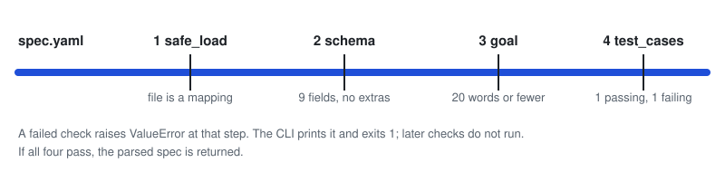

<h1 align="center">covenant</h1>

<p align="center">A spec schema and validator for agent orchestration, checking YAML specs against one canonical contract.</p>

<p align="center">
<picture>
<source media="(prefers-color-scheme: dark)" srcset="docs/how-it-works-dark.svg">

</picture>
</p>
<p align="center">The order of checks in <code>validator.py</code>. Drawn from the code, not a recording.</p>

## Why

Agent specs written as free text are hard to check. covenant fixes the shape of a spec: nine required fields, a short goal, and at least one passing and one failing test case. Anything else is rejected with a message naming the rule.

The schema (`schema/spec_schema.json`) is the source of truth. Rules JSON Schema cannot express (word count, test case types) live in `validator.py`.

## Requirements

- Python 3.x with a virtual environment
- `pyyaml` and `jsonschema>=4.0`

```bash
source .venv/bin/activate
pip install -r requirements.txt
```

## Usage

```bash
python3 validator.py <path_to_spec.yaml>
```

**Valid spec:**
```
✓ Valid spec: examples/valid_spec.yaml
  goal: The spec validator rejects any YAML file that violates the schema.
  test_cases: 4 (1 passing, 3 failing)
```

**Invalid spec:**
```
✗ Invalid spec: Schema validation failed: 'goal' is a required property
```

## Spec Format

Every spec must be a YAML file with these 9 fields. The validator enforces the structure (required fields, types, item counts), the goal word limit and the passing/failing test case rule. The other wording rules in the Rule column, such as "measurable" and "testable", are conventions the validator does not check.

| Field | Type | Rule |
|-------|------|------|
| `goal` | string | One sentence, ≤ 20 words |
| `success_criteria` | string[] | ≥ 1 item; each must be measurable |
| `constraints` | string[] | ≥ 1 item; only include testable constraints |
| `preconditions` | string[] | ≥ 1 item; must be true before execution |
| `postconditions` | string[] | ≥ 1 item; must be true after execution |
| `test_cases` | object[] | ≥ 2 items; must include ≥ 1 `passing` and ≥ 1 `failing` |
| `non_goals` | string[] | ≥ 1 item; explicit scope boundaries |
| `protected` | string[] | Things that must not be touched |
| `signal_budget` | integer | Max word budget (unenforced in this version) |

Each `test_cases` item has: `input` (string), `expected_output` (string), `type` (`"passing"` or `"failing"`).

`additionalProperties: false` is set — undeclared fields cause a validation error.

## Examples

```bash
# Should pass
python3 validator.py examples/valid_spec.yaml

# Should fail: missing required field 'goal'
python3 validator.py examples/invalid_spec.yaml

# Should fail: goal is 21 words
python3 validator.py examples/invalid_goal_spec.yaml
```

## Project Structure

```
covenant/
├── schema/
│   └── spec_schema.json      # JSON Schema draft-07 — source of truth
├── examples/
│   ├── valid_spec.yaml        # Passing fixture
│   ├── invalid_spec.yaml      # Failing: missing 'goal' field
│   └── invalid_goal_spec.yaml # Failing: goal exceeds 20 words
├── validator.py               # Load YAML + enforce schema + business rules
├── requirements.txt           # pyyaml, jsonschema>=4.0, anthropic
└── .env.example               # ANTHROPIC_API_KEY placeholder
```

## Environment

`validator.py` does not call the Anthropic API or read `.env`. `requirements.txt` lists `anthropic` and `.env.example` holds an `ANTHROPIC_API_KEY` placeholder for components outside this repo. If you use them, copy the file and set your own key:

```bash
cp .env.example .env
# edit .env and set ANTHROPIC_API_KEY
```
